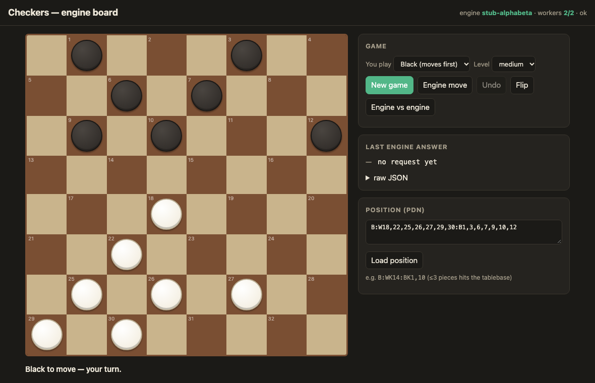
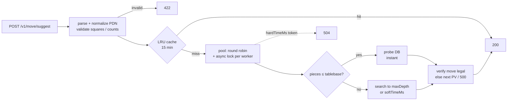

<div align="center">

# ♛ Checkers Move API

**REST API that takes a checkers position in PDN and returns the best move.**<br>
ASP.NET Core 8 · built for IIS · Chinook adapter with a worker pool · runs out of the box on its own engine

[](https://github.com/bogdan734/checkers-chinook-api/actions/workflows/ci.yml)


[Spec checklist](#spec-checklist) · [API](#api) · [Run it](#run-it) · [Chinook on Windows + IIS](#real-chinook-on-windows--iis) · [Acceptance check](#acceptance-check)



</div>

> **Engine note.** Chinook and KingsRow, along with their 2–8 piece endgame databases, are proprietary Windows
> binaries with no public download. This repo includes a working Chinook adapter (a pool of long-lived worker
> processes) and its own engine (alpha-beta search plus a 3-piece endgame tablebase), so the service works end to
> end without them. One setting switches between the two: `Engine:Type`. The two acceptance criteria that depend on
> the real 8-piece databases are checked against the built-in engine here and by a script on your server
> ([Acceptance check](#acceptance-check)).

---

## Contents

- [Spec checklist](#spec-checklist)
- [API](#api)
- [Request flow](#request-flow)
- [Configuration](#configuration)
- [Run it](#run-it)
- [Real Chinook on Windows + IIS](#real-chinook-on-windows--iis)
- [Acceptance check](#acceptance-check)
- [Tests and CI](#tests-and-ci)
- [Project layout](#project-layout)

## Spec checklist

| Requirement from the brief | Where | Checked by |
|---|---|---|
| `POST /v1/move/suggest` with the request and response from the brief (`positionKey` is `pdn:` + canonical PDN) | `MoveController`, `MoveService` | `AcceptanceTests` |
| `POST /v1/move/validate` → `{ legal }` | `MoveController` | `AcceptanceTests`, `RulesTests` |
| `GET /healthz` → `{ ok, workers }` (503 until every worker is warm) | `HealthController` | `Healthz_is_ok_on_startup_with_two_workers` |
| Levels `weak` / `medium` / `strong` with the depth and time rules, no randomness | `MoveService` | `AcceptanceTests` |
| Flow: parse and normalize PDN → probe tablebase → search → verify legality (next PV move or 500) → LRU cache 15 min | `MoveService`, `Pdn`, `LruCache` | `AcceptanceTests`, `PoolAndCacheTests` |
| `EngineAdapter` with `setPosition(pdn)` and `search(limits)` → `{ bestMove, pv, scoreOrWDL, nodes, depth, tablebaseHit }` | `IEngineAdapter` | `ChinookProcessTests` |
| Chinook over a CLI, small pool of long-lived worker processes, never one per request | `ChinookEngineAdapter`, `EnginePool` | `ChinookProcessTests`, `PoolAndCacheTests` |
| 2 workers created and warmed on app start, round robin with an async lock per worker | `EngineWarmupService`, `EnginePool` | `PoolAndCacheTests` |
| `softTimeMs` enforced in the adapter, `hardTimeMs` with a `CancellationToken` in the controller | `MoveController`, adapters | `Hard_timeout_returns_504` |
| JSON log line per request: `requestId`, `timeMs`, `depth`, `nodes`, `tablebaseHit` | `RequestLogging` | `PoolAndCacheTests` |
| Normal ASP.NET Core app behind IIS, no Windows Service | `web.config` (in-process hosting) | `dotnet publish` output |
| `appsettings.json` exactly as in the brief | `appsettings.json` | |
| Acceptance: health ok, tablebase < 50 ms, strong midgame < 600 ms, invalid PDN → 422, timeout → 504 | all of the above | `AcceptanceTests`, `tools/AcceptanceCheck`, CI |
| Simple board interface to check the service against the engine | `wwwroot/index.html` | |

## API

### `POST /v1/move/suggest`

```bash
curl -s http://localhost:5000/v1/move/suggest -H 'content-type: application/json' -d '{
  "gameId": "checkers-8x8",
  "state":  { "notation": "PDN", "position": "B:W18,19,22,25,27,28,30,32:B1,5,6,7,10,12,14,16" },
  "level":  "strong",
  "limits": { "maxDepth": 16, "softTimeMs": 550, "hardTimeMs": 1200 }
}'
```

```json
{
  "engine": "stub-alphabeta",
  "bestMove": "14x23",
  "pv": ["14x23", "27x18", "16x23", "28-24", "6-9"],
  "scoreOrWDL": 137,
  "depth": 13,
  "nodes": 1555108,
  "positionKey": "pdn:B:W18,19,22,25,27,28,30,32:B1,5,6,7,10,12,14,16",
  "info": { "tablebaseHit": false, "timeMs": 334, "cached": false }
}
```

- **`scoreOrWDL`** is a number (centipawns, from the side to move) for a search result, or `"WIN"` / `"DRAW"` / `"LOSS"` for a tablebase hit.
- **Moves** list landing squares: `11-15`, `22x15`, `9x18x27`. Capturing is mandatory, as in English draughts.
- **Positions** can be given as `B:W21,22,K30:B1-12`, as `[FEN "…"]`, or as `start`. Kings take a `K` prefix, and ranges are allowed.

| level | depth | soft time | randomness |
|---|---|---|---|
| `weak` | 7 | 100 ms | none |
| `medium` | 11 | 250 ms | none |
| `strong` | 16 | 550 ms | none; probes the tablebase first |
| *(omitted)* | 14 | `Limits:DefaultSoftTimeMs` | none |

Any field you set in `limits` overrides the level's value.

### `POST /v1/move/validate`

```json
{ "position": "start", "move": "11-15" }        →   { "legal": true }
```

### `GET /healthz`

```json
{ "ok": true, "workers": 2, "configured": 2, "engine": "stub-alphabeta" }
```
Returns **503** with `ok: false` until every worker is warm, for example when the engine binary is missing.

### Errors

All errors share one shape: `{ "code": "...", "message": "...", "requestId": "..." }`.

| status | when |
|---|---|
| **422** | invalid PDN or square, bad piece count, man on the promotion row, unknown level, bad limits, no legal moves |
| **504** | `hardTimeMs` expired. The worker is killed and respawned, so the pool recovers |
| **500** | the engine returned a move that is illegal in the root position, and no PV entry was legal either |

## Request flow



## Configuration

`appsettings.json` uses the production values from the brief:

```json
{
  "Engine": { "Type": "chinook", "Path": "C:\\engines\\chinook\\chinook.exe", "Workers": 2, "Databases": "D:\\tb\\chinook" },
  "Cache":  { "Capacity": 20000, "TtlMinutes": 15 },
  "Limits": { "DefaultSoftTimeMs": 300, "DefaultHardTimeMs": 1200 }
}
```

| key | meaning |
|---|---|
| `Engine:Type` | `chinook` (external process pool) or `stub` (built-in engine). Development and Docker use `stub` |
| `Engine:Args` | extra arguments for the engine executable. `--db "<Databases>"` is appended automatically |
| `Engine:TablebasePieces` | size of the built-in tablebase: 3 by default, 4 works but is slow and memory-hungry |
| `Engine:StartupTimeoutMs` | how long to wait for `readyok` during warm-up |

Any key can also be set from an environment variable, e.g. `Engine__Type=stub`.

## Run it

**.NET SDK**
```bash
dotnet run --project src/CheckersApi          # Development profile → built-in engine; open / for the board
```

**Docker**
```bash
docker build -t checkers-api .
docker run -p 8080:8080 checkers-api          # http://localhost:8080 ; honours $PORT
```

## Real Chinook on Windows + IIS

The quickest start is the ready-made package from the [latest release](https://github.com/bogdan734/checkers-chinook-api/releases/latest): `checkers-api-iis-win-x64.zip` holds the published app, `web.config` and the reference engine in `engine\`. To build it yourself:

1. Install the **.NET 8 Hosting Bundle** and restart IIS.
2. Publish the app:
   ```powershell
   dotnet publish src/CheckersApi -c Release -o C:\inetpub\checkers-api
   ```
3. Place the engine at `C:\engines\chinook\chinook.exe` and the databases at `D:\tb\chinook`.
4. Chinook has no command-line interface of its own, so `Engine:Path` must point to an executable that speaks this
   protocol. A thin shim around the CheckerBoard engine DLL (`getmove`) or around KingsRow is enough:

   ```text
   isready                                  -> readyok
   position <canonical pdn>
   go depth <d> time <ms> tb <0|1>          -> info depth <d> nodes <n> score cp <x>|wdl <WIN|DRAW|LOSS> tb <0|1> pv <m1> <m2> ...
                                               bestmove <move>          (or: bestmove none)
   quit
   ```

   [`src/CheckersApi.EngineCli/Program.cs`](src/CheckersApi.EngineCli/Program.cs) is an 80-line reference
   implementation of this protocol, and the integration tests run the adapter against it. To try the worker pool on
   Windows before the real engine is in place, set `Engine:Path` to `<site>\engine\CheckersApi.EngineCli.exe`.
5. Configure the IIS site:
   - App pool: **No Managed Code**, **Start Mode = AlwaysRunning**, **Idle Time-out = 0**.
   - Site: **Preload Enabled = true**, with the *Application Initialization* feature installed.

   `web.config` (in-process hosting, stdout log) is already included.
6. Open `GET /healthz` and check that `ok` is `true` and `workers` is `2`, then run the [acceptance check](#acceptance-check).

No Windows Service is involved. The engine workers run as child processes of `w3wp.exe`.

## Acceptance check

`tools/AcceptanceCheck` runs the five criteria from the brief against any running instance and exits with 1 if one fails:

```bash
dotnet run --project tools/AcceptanceCheck -c Release -- http://localhost:5000
```

```text
PASS  healthz is ok on startup  (HTTP 200, workers=2)
PASS  tablebase position answers in < 50 ms with tablebaseHit  (3 ms, tablebaseHit=True)
PASS  strong midgame answers in < 600 ms with a legal move  (14x23 in 412 ms, depth 13, nodes 1555108)
PASS  invalid PDN returns 422  (HTTP 422)
PASS  hardTimeMs expiry returns 504  (HTTP 504 after 34 ms)
```

The default tablebase position has 3 pieces, which the built-in engine covers. On a server with the real Chinook
databases, pass an 8-piece position (and use `--midgame-pdn`, `--tb-max-ms`, `--strong-max-ms` to change the other inputs):

```bash
dotnet run --project tools/AcceptanceCheck -c Release -- http://localhost/ --tb-pdn "B:W19,23,K27,31:B4,K8,12,K16"
```

## Tests and CI

```bash
dotnet test        # 50 tests. The app targets net8.0; the test host needs the .NET 9 SDK
```

| acceptance criterion | test |
|---|---|
| `healthz` ok on startup | `Healthz_is_ok_on_startup_with_two_workers` |
| tablebase position returns in < 50 ms with `tablebaseHit: true` | `Tablebase_position_returns_fast_with_tablebaseHit` |
| strong midgame returns a legal move in < 600 ms | `Midgame_strong_returns_legal_move_under_600ms` |
| invalid PDN → 422 | `Invalid_pdn_returns_422` |
| timeout → 504 | `Hard_timeout_returns_504`, `Hard_timeout_kills_worker_and_pool_recovers` |

Other tests cover:

- move generation, checked against the known perft counts for English draughts up to depth 6
- multi-jumps and crowning
- PDN parsing
- tablebase correctness
- round robin and the per-worker lock
- LRU eviction and TTL expiry
- JSON log fields
- the Chinook process adapter running against the reference CLI, including a missing binary making `/healthz` return 503

CI runs the tests on **Ubuntu and Windows Server 2022**, then starts the published service and runs the acceptance check against it.

## Project layout

```text
src/
  Checkers.Core/            rules, move generation, PDN, search, endgame tablebase
  CheckersApi/              controllers, MoveService, EnginePool, adapters, LRU cache, JSON logging, wwwroot board
  CheckersApi.EngineCli/    reference engine process (line protocol) = template for a Chinook shim
tools/AcceptanceCheck/      the five acceptance criteria against a running instance
tests/CheckersApi.Tests/    unit + integration + acceptance tests
Dockerfile · render.yaml · .github/workflows/ci.yml
```

MIT, see [LICENSE](LICENSE).
